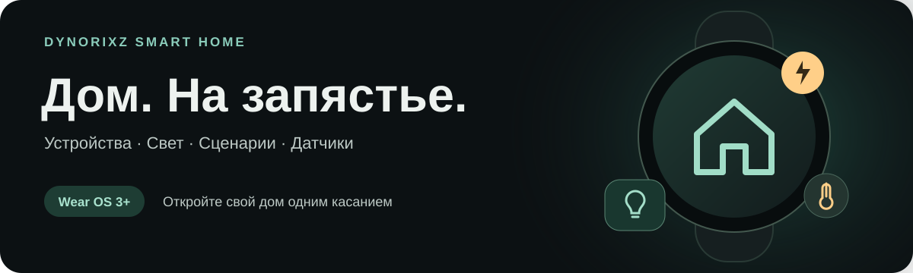

  

  
  
  
  

  <strong>Свет, приборы и сценарии «Дома с Алисой» — прямо на часах.</strong> 
  Фотографии устройств, крупные показания датчиков, системные плитки и действия с циферблата.

  <a href="https://github.com/Dynorixz/dynorixz-smart-home-wear-os/releases/download/v1.8.0/Dynorixz-Home-1.8.0-Wear.apk"><strong>↓ Скачать APK для часов</strong></a>
  &nbsp; · &nbsp; <a href="docs/installation.md">Установить и войти</a>
  &nbsp; · &nbsp; <a href="docs/screenshots.md">Все скриншоты</a>
  &nbsp; · &nbsp; <a href="CHANGELOG.md">История изменений</a>

> Независимый клиент для Wear OS, не официальный продукт Яндекса. Устройства и доступные функции загружаются из вашего аккаунта через публичный API Яндекса.

## Посмотрите, как это работает

<table>
  <tr>
    <td align="center" width="33%"></td>
    <td align="center" width="33%"></td>
    <td align="center" width="33%"></td>
  </tr>
  <tr>
    <td align="center"><strong>Дом с фотографиями</strong> Открыть прибор или сразу переключить питание</td>
    <td align="center"><strong>Удобное управление светом</strong> Большие кнопки, палитра и точная настройка</td>
    <td align="center"><strong>Понятные показания</strong> Состояния по-русски, крупные значения и единицы</td>
  </tr>
</table>

Скриншоты в README получены из интерфейса приложения на тестовых данных. На ваших часах будут ваши приборы, комнаты, сценарии и показания. [Полная галерея с пояснениями →](docs/screenshots.md)

## Что умеет приложение

| Возможность | Что можно сделать |
| --- | --- |
| **Мой дом** | Выбрать «Список», «Панель» или «Галерею», открыть комнаты, найти прибор, настроить избранное |
| **Свет** | Переключить питание, изменить яркость, выбрать цвет и температуру белого света, если это поддерживает лампа |
| **Другие приборы** | Менять доступные режимы, громкость, температуру и переключатели — по возможностям устройства |
| **Датчики** | Смотреть температуру, влажность, открытие, движение, протечку, заряд и другие переданные показания |
| **Группы и сценарии** | Управлять группой приборов или запускать сценарий Яндекса |
| **Плитки часов** | Получить быстрый доступ к действиям дома, свету и датчикам свайпом с циферблата |
| **Ярлыки циферблата** | Назначить отдельное действие каждому поддерживаемому слоту |

В «Галерее» карточка открывает прибор, отдельная кнопка управляет питанием, а удерживание меняет избранное. Фотографии иллюстрируют тип устройства и включены в APK: при открытии экрана их не нужно скачивать. [Источники изображений](docs/device-art/README.md).

## Новое в 1.8.0: три системные плитки

<table>
  <tr>
    <td align="center" width="33%"></td>
    <td align="center" width="33%"></td>
    <td align="center" width="33%"></td>
  </tr>
  <tr>
    <td align="center"><strong>Умный дом</strong> До трёх приборов, групп или сценариев</td>
    <td align="center"><strong>Свет</strong> До трёх ламп с быстрым переключением</td>
    <td align="center"><strong>Датчики</strong> До двух приборов с крупными показаниями</td>
  </tr>
</table>

**Добавить на Samsung:** с циферблата свайпайте справа налево до конца → **Добавить карточки** / **Добавить плитки** → **Dynorixz Smart Home** → выберите плитку. Названия системных пунктов зависят от версии Wear OS.

**Настроить:** нажмите шестерёнку на плитке или откройте **Home → Настройки → Плитки часов**. У каждой плитки отдельный набор карточек и порядок. Для «Умного дома» выберите действия; «Свет» и «Датчики» без ручного выбора подбирают подходящие приборы автоматически.

Плитки показывают давность снимка данных. Нажатие датчика открывает подробности, а команда питания сначала проверяет актуальное состояние. [Подробности и настройка плиток →](docs/tiles-1.8.0.md)

В этом же обновлении исправлена обработка пустых необязательных полей ответа датчика и старого предупреждения «Получен некорректный ответ». Неизвестные значения не заменяются нулями, ошибки команд и настоящие ошибки сервера остаются видимыми.

## Установка за несколько шагов

1. Скачайте **[Dynorixz-Home-1.8.0-Wear.apk](https://github.com/Dynorixz/dynorixz-smart-home-wear-os/releases/download/v1.8.0/Dynorixz-Home-1.8.0-Wear.apk)** и установите на часы с **Wear OS 3 или новее**.
2. Откройте Home на часах и нажмите **Войти**.
3. На сопряжённом Android-телефоне откроется браузер Яндекса. Войдите и разрешите доступ к умному дому. Во время входа оставьте Home открытым на часах.
4. Дождитесь загрузки приборов. Добавьте плитки и ярлыки циферблата по желанию.

**Home на телефоне устанавливать не нужно.** Для входа через телефон нужны его браузер, Google Play Services и штатное приложение Galaxy Wearable / Wear OS. Пароль вводится на странице Яндекс ID. Если на часах есть браузер, доступен также вход непосредственно на часах.

Готовый релиз уже настроен: создавать OAuth-приложение, вводить Client ID и собирать проект обычному пользователю не требуется. Необязательный `Phone-optional.apk` сохранён для совместимости со старым способом возврата авторизации.

### Обновление с предыдущих версий

- **Сборки 1.4.0–1.8.0 с текущей подписью:** устанавливайте APK поверх, чтобы сохранить вход и настройки.
- **Публичные релизы 1.2.0 / 1.3.0:** у них другой сертификат. Android не установит новую версию поверх. Понадобится однократная переустановка с повторным входом; локальные настройки и назначенные действия потребуется настроить заново.

[Пошаговая установка через ADB, проверка подписи и решение проблем →](docs/installation.md)

## Действия прямо с циферблата

Удерживайте циферблат Samsung → **Изменить** → выберите слот дополнения → **Действие дома** в группе Dynorixz Smart Home. Выберите прибор, группу или сценарий и завершите настройку циферблата.

Для прибора и группы доступны **Переключить**, **Включить**, **Выключить**, **Открыть управление**. Сценарий запускается одним нажатием. Каждый слот хранит свой выбор; доступные формы и размещение зависят от циферблата.

[Инструкция по ярлыкам циферблата →](docs/complications.md)

## Данные, связь и совместимость

- Часам нужен интернет и сохранённый вход в Яндекс ID. Поддержаны только возможности, которые устройство объявляет в API.
- При отсутствии связи приложение показывает сохранённые данные и их давность. Плитки и ярлыки обновляются с учётом системного расписания Wear OS, поэтому не являются непрерывным мониторингом.
- Токен хранится в зашифрованном виде с ключом Android Keystore. Используются Authorization Code + PKCE и проверка `state`; `CLIENT_SECRET` в приложении нет.
- Интерфейс поддерживает тёмную, светлую и системную тему. Плитки используют постоянную тёмную палитру с мятными и янтарными акцентами.

## Для разработчиков

| Раздел | Содержание |
| --- | --- |
| [Сборка и собственный OAuth](docs/development.md) | Требования, конфигурация, команды Gradle, подпись и структура проекта |
| [Скриншоты](docs/screenshots.md) | Главный экран, каталог, свет, датчики и плитки с пояснениями |
| [Изменения 1.8.0](docs/releases/1.8.0.md) | Сводка публичного обновления с 1.3.0, установка и проверка файлов |
| [История версий](CHANGELOG.md) | Изменения по версиям |

Для релиза 1.8.0 пройдены **143 автоматических теста**, статический анализ завершён без ошибок. Release APK с R8 проверен на Samsung Galaxy Watch: вход сохранился, плитки отображаются и открывают свои настройки. Дополнительные проверки включают круглый экран 192 dp и экран 227 dp с увеличенным шрифтом.

Нашли проблему? [Создайте issue](https://github.com/Dynorixz/dynorixz-smart-home-wear-os/issues/new), укажите модель часов, версию Wear OS, версию Home и шаги воспроизведения. Не прикладывайте токены, пароли и приватные ключи.
