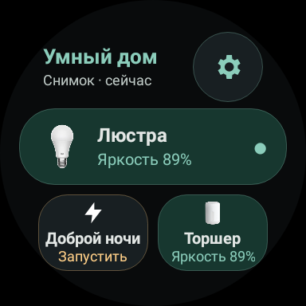
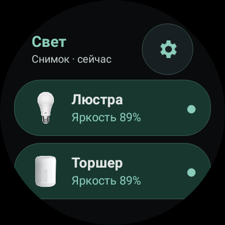
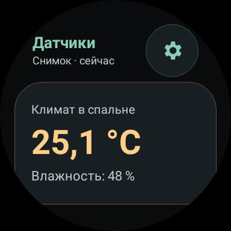

# Dynorixz Smart Home 1.8.0

Публичное обновление клиента «Дома с Алисой» для Wear OS: новый вид дома, удобное управление светом, крупные показания датчиков и три системные плитки.

[Скачать Wear APK](https://github.com/Dynorixz/dynorixz-smart-home-wear-os/releases/download/v1.8.0/Dynorixz-Home-1.8.0-Wear.apk) · [Инструкция по установке](../installation.md) · [Все скриншоты](../screenshots.md)

## Три плитки для быстрого доступа

<p>
  
  
  
</p>

- **Умный дом:** до трёх выбранных приборов, групп или сценариев.
- **Свет:** до трёх ламп с фотографиями и быстрым питанием.
- **Датчики:** до двух приборов с крупными значениями и переходом к подробностям.

Шестерёнка открывает настройку соответствующей плитки. У каждой свой набор и порядок. На Samsung добавление находится в конце карусели: «Добавить карточки» / «Добавить плитки» → Dynorixz Smart Home.

## Что появилось после публичной 1.3.0

| Область | Изменения |
| --- | --- |
| **Главный экран** | Третий стиль «Галерея», фотографии устройств, избранное и отдельные кнопки питания |
| **Каталог** | Переработанные карточки, поиск и фильтры |
| **Свет** | Большие элементы управления, подписанная палитра, оттенок и насыщенность, пресеты белого света, кнопки −/+ |
| **Датчики** | Крупные информационные карточки, русские состояния, корректные единицы и возраст показаний |
| **Циферблат** | Независимое действие для каждого поддерживаемого слота: питание, открытие управления или сценарий |
| **Авторизация** | Вход в браузере сопряжённого телефона через штатный Wear OS / Galaxy Wearable; отдельный Home на телефоне не нужен |

В 1.8.0 также исправлена обработка пустых необязательных полей в ответе отдельного прибора. Корректное значение не теряется из-за некорректного соседнего свойства. Известные единицы сохраняются; старое предупреждение обновления снимается при поступлении свежих изменившихся данных. Настоящие ошибки сервера и команд не скрываются.

## Установка и совместимость

Основной установщик — **`Dynorixz-Home-1.8.0-Wear.apk`**. Нужны Wear OS 3+, интернет на часах и аккаунт Яндекса с устройствами. `Phone-optional.apk` для обычного входа не требуется.

**При переходе с публичных 1.2.0 / 1.3.0 сертификат изменился.** Android не может обновить эти APK поверх; потребуется однократная переустановка и повторный вход, с повторной настройкой локального избранного и действий. Сборки 1.4.0–1.8.0 с текущей подписью обновляются через `adb install -r` с сохранением данных. [Полная инструкция](../installation.md).

После установки: Home → Войти → завершите вход в браузере телефона → оставьте приложение на часах открытым до загрузки устройств.

## Проверка релиза

- Wear: **1.8.0 (9)**, release с R8 и shrink resources.
- **143 автоматических теста пройдены**, статический анализ без ошибок.
- Установка поверх рабочей версии проверена на Samsung Galaxy Watch, вход сохранён.
- Системные плитки, фотографии и переходы в их настройки проверены на часах.
- Скриншоты документации используют тестовый дом; это не список приборов пользователя.

SHA-256 сертификата:

```text
73:67:BA:27:02:15:19:4A:AD:1B:2C:77:D6:9A:28:E8:49:17:6A:AD:A8:B6:AB:BD:D2:1D:5E:FD:48:78:8E:ED
```

С релизом доступны подписанные APK, полный архив исходников и `SHA256SUMS.txt`. Исходники включают ресурсы, документацию, файлы сборки и Gradle Wrapper. Ключ подписи, пароли, токены, локальная конфигурация и установленные SDK в архив не входят.
