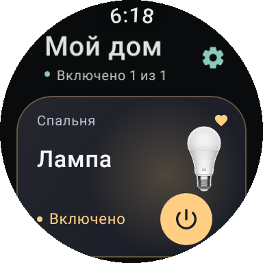
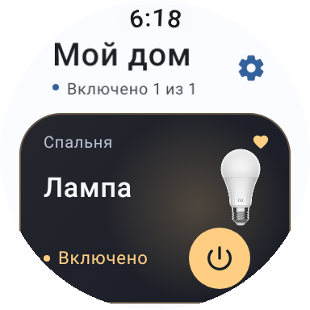
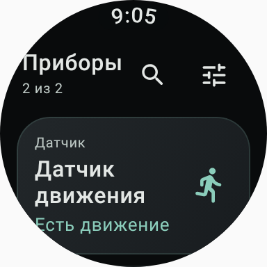
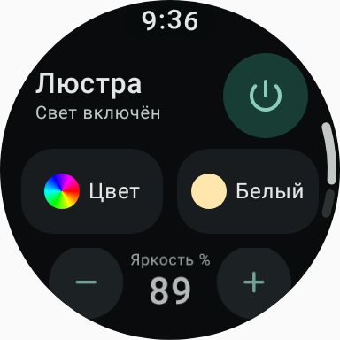
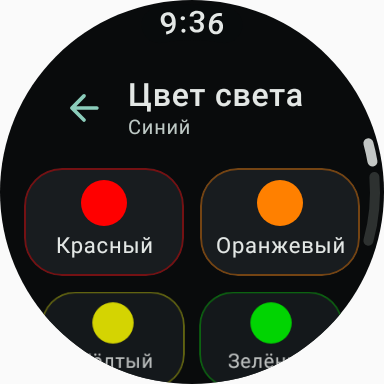
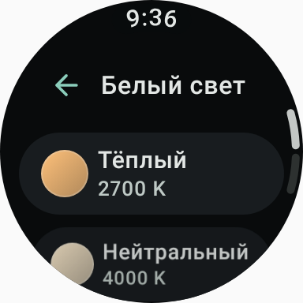
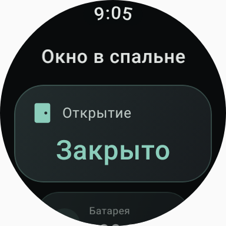
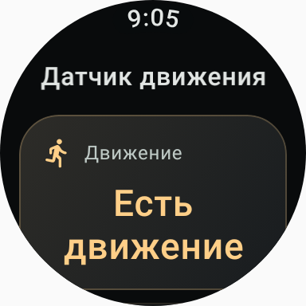
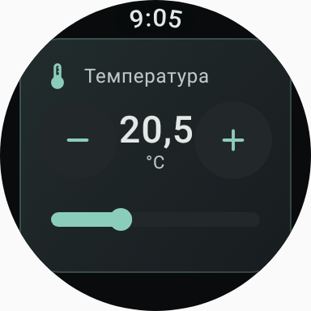

# Галерея интерфейса

[← Главная](../README.md) · [Установить](installation.md) · [Скачать](https://github.com/Dynorixz/dynorixz-smart-home-wear-os/releases/latest)

Это снимки настоящего интерфейса на тестовом доме, полученные автоматическими проверками. В установленном приложении показываются данные вашего аккаунта. Фотографии иллюстрируют тип прибора; конкретный внешний вид модели может отличаться.

## Главный экран и каталог

<table>
  <tr>
    <td align="center"></td>
    <td align="center"></td>
    <td align="center"></td>
  </tr>
  <tr>
    <td align="center"><strong>Галерея</strong> Фотография, комната, состояние, избранное и отдельное питание</td>
    <td align="center"><strong>Светлая тема</strong> Тот же интерфейс с адаптированными цветами</td>
    <td align="center"><strong>Все приборы</strong> Каталог, поиск, фильтры и быстрый доступ к управлению</td>
  </tr>
</table>

Касание карточки открывает прибор. Кнопка питания работает отдельно; удерживание карточки меняет избранное. Стиль экрана выбирается в настройках: «Список», «Панель» или «Галерея».

## Свет: от быстрого действия к точной настройке

<table>
  <tr>
    <td align="center"></td>
    <td align="center"></td>
    <td align="center"></td>
  </tr>
  <tr>
    <td align="center"><strong>Питание и яркость</strong> Большая кнопка, шаги −/+ и прокручиваемые регуляторы</td>
    <td align="center"><strong>Цвет</strong> Крупные образцы с подписями и отметкой выбора</td>
    <td align="center"><strong>Белый свет</strong> Готовые температуры и точный диапазон прибора</td>
  </tr>
</table>

Для произвольного цвета доступны отдельные регуляторы оттенка и насыщенности. Числовые параметры можно менять безелем после касания шкалы. Отображаются только функции, поддерживаемые конкретной лампой. [Подробнее об управлении светом](light-controls-1.7.0.md).

## Датчики и другие приборы

<table>
  <tr>
    <td align="center"></td>
    <td align="center"></td>
    <td align="center"></td>
  </tr>
  <tr>
    <td align="center"><strong>Открытие</strong> Крупное состояние вместо отключённой серой кнопки</td>
    <td align="center"><strong>Движение</strong> Понятные события, единицы измерения и возраст данных</td>
    <td align="center"><strong>Термостат</strong> Шкала и кнопки −/+ с ограничениями устройства</td>
  </tr>
</table>

Приложение также выводит температуру, влажность, заряд и другие свойства, переданные API. Отсутствующие значения помечаются явно. [Описание карточек и регуляторов](device-screens-1.6.0.md).

## Системные плитки Wear OS

<table>
  <tr>
    <td align="center"></td>
    <td align="center"></td>
    <td align="center"></td>
  </tr>
  <tr>
    <td align="center"><strong>Умный дом</strong> До трёх действий, первая карточка крупнее</td>
    <td align="center"><strong>Свет</strong> Лампы, фотографии и питание одним нажатием</td>
    <td align="center"><strong>Датчики</strong> Крупное значение и переход к подробностям</td>
  </tr>
</table>

Каждая плитка настраивается независимо через шестерёнку. Можно выбрать до двух датчиков; при одном приборе выводится ещё одно доступное показание. Плитки показывают давность снимка, а не обещание непрерывного обновления. [Как добавить и настроить](tiles-1.8.0.md).

## Действия на циферблате

Источник «Действие дома» добавляется в поддерживаемый слот циферблата через системный редактор. Вид и размер дополнения определяет сам циферблат. [Пошаговая настройка](complications.md).
